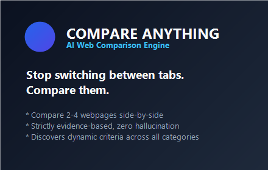
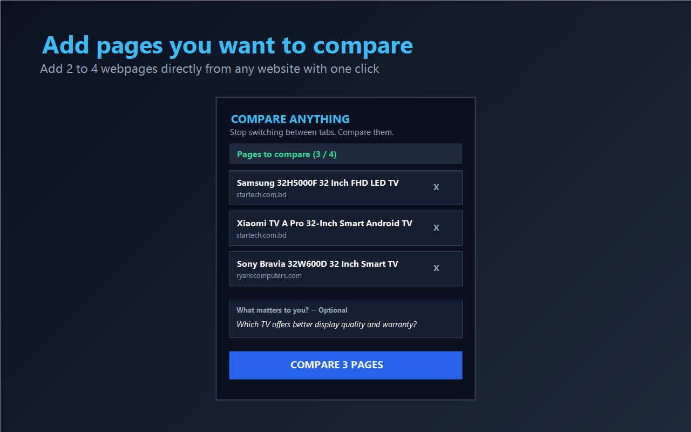
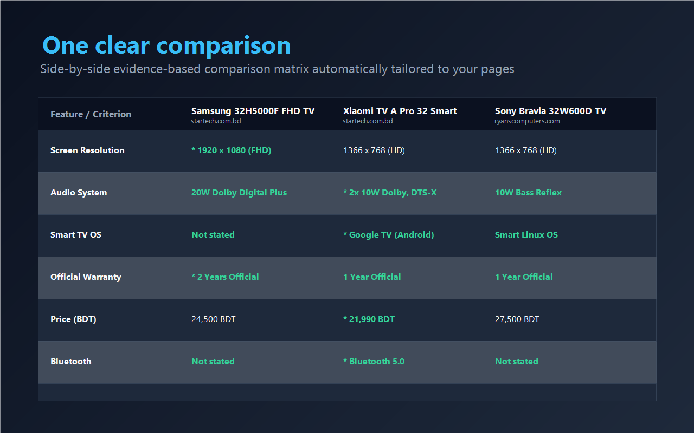
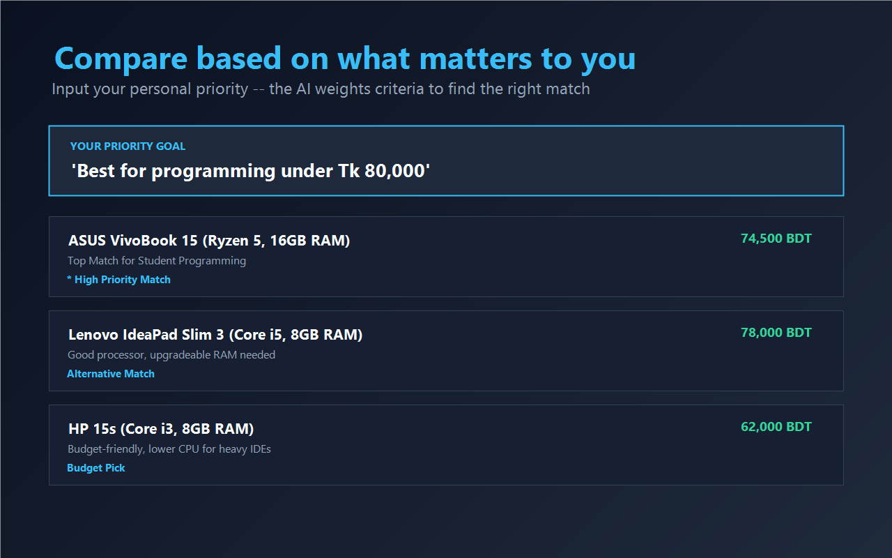
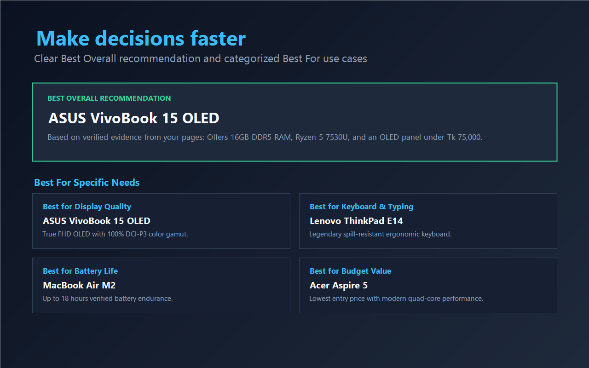

# Compare Anything

> *"Stop switching between tabs. Compare them."*



**Compare Anything** is a privacy-first Chrome Extension and AI-powered comparison engine that allows users to explicitly select 2 to 4 webpages across different websites, create non-destructive structured snapshots, and receive an evidence-based side-by-side comparison table without juggling browser tabs.

---

## 📸 Screenshots

| Screenshot 1 | Screenshot 2 |
| :---: | :---: |
|  |  |
| *Add 2–4 pages to compare* | *One clean side-by-side comparison* |

| Screenshot 3 | Screenshot 4 |
| :---: | :---: |
|  |  |
| *Compare based on your priorities* | *Best Overall & Best For recommendations* |

---

## ✨ What It Does

When making decisions online (buying laptops, picking software subscriptions, evaluating job offers, or selecting online courses), users typically juggle between 5–10 browser tabs, struggling to remember which product has which specification.

**Compare Anything** solves this in seconds:
1. You explicitly add 2 to 4 webpages you are evaluating.
2. You optionally enter what matters to you (e.g., *"Which laptop has better battery life under $1,000?"*).
3. Compare Anything extracts structured specifications locally, sends them to our secure evidence-based AI backend, and displays a dedicated visual comparison table.

---

## 🚀 Key Features

* **Compare 2–4 Webpages**: Compare items across completely different websites, marketplaces, and platforms.
* **Evidence-Based Comparison**: Evaluates **only** the factual evidence explicitly contained on the selected pages. Never invents, hallucinates, or guesses missing facts.
* **Dynamic Criteria Discovery**: Automatically discovers relevant comparison criteria based on the content (e.g., CPU & RAM for laptops; Salary & Remote Policy for jobs; Curriculum & Mentorship for courses).
* **Missing Information Detection**: Clearly flags missing specifications as `"Not stated"` rather than making assumptions.
* **Objective Winners & Inconclusive Evidence**: Recommends a "Best Overall" only when supported by facts; reports `"No clear winner"` when evidence is tied or inconclusive.
* **Export & Sharing Tools**:
  - **Copy Comparison**: Formatted markdown/plain-text summary copied to clipboard.
  - **Download CSV**: Standard RFC 4180 spreadsheet export.
  - **Share Image (PNG)**: Client-side generated comparison card ready to share on social media or messaging apps.
* **Privacy by Design**: No user accounts, no tracking, no ads, no history scanning, and stateless backend operation.

---

## 🔄 How It Works

```text
Tab 1 ─┐
Tab 2 ─┼──→ COMPARE ANYTHING (Extension) ──→ AI Backend ──→ One Decision Matrix
Tab 3 ─┘
```

1. **Add a page**: Browse to your first option $\rightarrow$ Open extension $\rightarrow$ Click **"Add Current Page"**.
2. **Add another**: Browse to alternative options and add them (up to 4 pages).
3. **Compare**: Optionally type your personal priority and click **"Compare Pages"**.
4. **Review Results**: The dedicated results tab opens instantly with:
   - Best Overall recommendation (or "No clear winner")
   - Full side-by-side specification table with winner highlights
   - "Best For" attribute badges
   - Key factual differences
   - Missing information breakdown
   - Safe source links back to original webpages

---

## 🏗️ Architecture & Project Structure

```text
compare-anything/
├── extension/                  # Chrome Extension (Manifest V3, React 18, TypeScript, Vite)
│   ├── src/
│   │   ├── popup/              # Extension popup UI (Popup.tsx, Popup.css)
│   │   ├── results/            # Full-page comparison dashboard (Results.tsx, Results.css)
│   │   ├── services/           # ApiService, ExtractionService, TabService
│   │   ├── extractors/         # PageExtractor, domUtils (~3,500 chars limit)
│   │   ├── storage/            # StorageService (chrome.storage.local)
│   │   └── utils/              # exportUtils (CSV/Text), urlUtils
│   ├── public/icons/           # Extension icons (16, 32, 48, 128 px)
│   ├── tests/                  # Vitest automated test suite (16/16 tests pass)
│   └── manifest.json           # Manifest V3 (activeTab, scripting, storage)
│
├── backend/                    # AI Backend (ASP.NET Core 10 Web API)
│   ├── Controllers/            # CompareController (POST /api/v1/compare)
│   ├── Services/               # ComparisonService, RateLimiterService
│   │   └── AI/                 # GroqProvider, OpenRouterProvider, PromptBuilder, AIResponseValidator
│   ├── DTOs/                   # CompareRequest & CompareResponse data models
│   ├── Middleware/             # ExceptionHandlingMiddleware (safe error responses)
│   ├── Configuration/          # AISettings, RateLimitSettings
│   └── appsettings.json        # Configuration with MaxTokens & model options
│
├── backend.Tests/              # Backend test suite (xUnit, 21/21 tests pass)
├── docs/                       # Documentation
│   ├── PRIVACY.md              # Privacy policy & data protection guarantees
│   ├── SUPPORT.md & support.html # Public support page & troubleshooting guide
│   ├── TESTING.md              # Automated test suites, multi-category validation & DoD
│   └── STORE-SUBMISSION.md     # Chrome Web Store copy, asset checklist & guidelines
├── landing/                    # Public landing page (index.html)
├── store-assets/               # Store screenshots (1280x800) & promo tile (440x280)
├── compare-anything-v1.0.0.zip # Verified production extension package
├── .env.example                # Sanitized environment variables template
└── LICENSE                     # MIT License
```

---

## 💻 Local Development Setup

### Prerequisites
* **Node.js**: v18 or v20+
* **.NET SDK**: 10.0 (`net10.0`)
* **Google Chrome**: Version 120+
* **Groq API Key**: Free key from [console.groq.com](https://console.groq.com)

---

### 1. Backend Setup

1. Open a terminal in the `backend/` directory:
   ```bash
   cd backend
   ```
2. Create your `.env` file from the template:
   ```bash
   cp .env.example .env
   ```
3. Set your Groq API key in `.env`:
   ```ini
   GROQ_API_KEY=gsk_your_actual_groq_api_key_here
   ```
4. Restore and run the backend:
   ```bash
   dotnet restore
   dotnet run --launch-profile "http"
   ```
   The backend will be listening on `http://127.0.0.1:5123`.

---

### 2. Extension Setup

1. Open a new terminal in the `extension/` directory:
   ```bash
   cd extension
   ```
2. Install dependencies:
   ```bash
   npm install
   ```
3. Run tests to verify the suite:
   ```bash
   npm test
   ```
4. Build the extension for production:
   ```bash
   npm run build
   ```
5. Load into Chrome:
   - Open Chrome and navigate to `chrome://extensions`.
   - Enable **Developer mode** (top-right toggle).
   - Click **Load unpacked** and select the `extension/dist` folder.
   - The **Compare Anything** icon will appear in your Chrome toolbar.

---

## 🧪 Testing

### Extension Tests (Vitest)
```bash
cd extension
npm test
```
*Tests: Page extraction, DOM noise stripping, storage management, CSV/Text export, API request serialization.*

### Backend Tests (xUnit)
```bash
dotnet test backend.Tests/
```
*Tests: Validation rules, 2-4 pages constraint, rate limiting, prompt injection defense, AI JSON sanitization, "Not stated" handling.*

### Multi-Category Live Verification
Run the automated multi-category test runner:
```powershell
powershell -ExecutionPolicy Bypass -File scripts/test_multicategory.ps1
```
*Tests: Products (3 TVs + student goal), Jobs (2 engineering roles), Courses (Bootcamp vs Degree).*

---

## 🔒 Privacy Approach

* **Explicit User Action Only**: Webpage content is extracted **only** when the user explicitly clicks **"Add Current Page"**.
* **Minimal Permissions**: Uses Chrome's `activeTab` model. Does **not** request broad `history` or `<all_urls>` permissions.
* **Bounded Snapshots**: Extracts structured visible content only (specs, tables, headings) up to ~3,500 characters. Scripts, ads, and cookies are stripped locally.
* **Zero Database Storage**: The backend is 100% stateless. No user comparisons or page texts are permanently stored.
* **Zero Accounts**: No user sign-up, email, or credentials required.
* **Server-Side Secrets**: All AI API keys reside exclusively on the server.

Read the complete [Privacy Policy](docs/PRIVACY.md).

---

## 🌐 Production Deployment Overview

* **Backend**:
  - Deploy to any Docker, Linux (systemd), Azure App Service, or AWS ECS container.
  - Set environment variables: `GROQ_API_KEY`, `ASPNETCORE_ENVIRONMENT=Production`.
  - Enforce HTTPS via reverse proxy (Nginx / Cloudflare / Caddy).
* **Extension**:
  - Update `API_BASE_URL` in `extension/src/config.ts` to your production HTTPS domain.
  - Run `npm run build` in `extension/`.
  - The production zip package is located at `compare-anything-v1.0.0.zip` ready for upload to the Chrome Web Store Developer Dashboard.

---

## 🏪 Chrome Web Store Information

* **Store Title**: `Compare Anything – AI Web Comparison`
* **Summary**: `"Add 2–4 web pages and get one clear AI comparison table based only on the information on those pages."`
* **Single-Purpose Description**: `"Compare Anything allows users to select webpages and generate an AI-assisted side-by-side comparison of the information contained on those selected pages."`
* Full submission checklist and copy in [docs/STORE-SUBMISSION.md](docs/STORE-SUBMISSION.md).

---

## 👥 Contributors

Built by the **Compare Anything** team as a production-grade comparison system.

---

## 📄 License

This project is licensed under the MIT License — see the [LICENSE](LICENSE) file for details.
